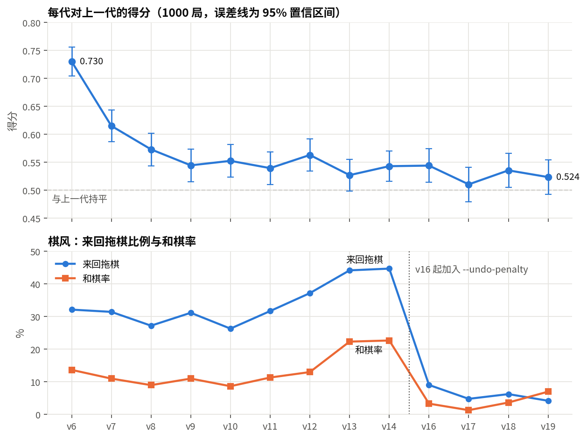
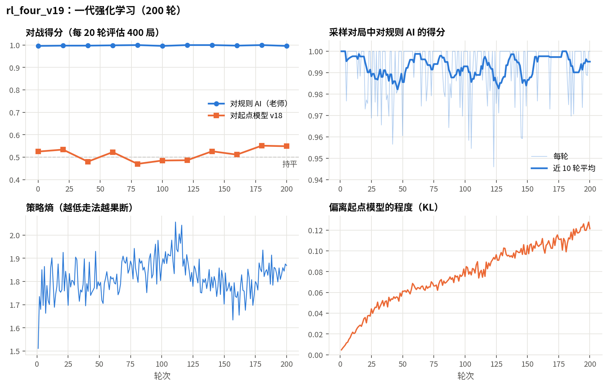
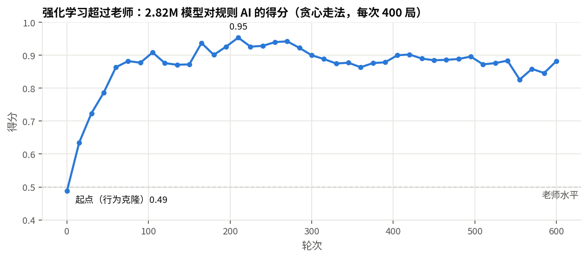

# siguo-ai · 四国军棋（暗棋）AI

**English** · A from-scratch AI for *Siguo Junqi* (four-player Chinese military chess with hidden pieces).
It has a C++ rules engine (≈400k plies/s per core) with exact belief tracking and leak tests, and a 14.7M-parameter
node-level Transformer with relation-biased attention, policy / belief / value heads.
The training pipeline goes from behaviour cloning of a rule-based agent to large-scale PPO self-play with an
opponent league, reward-shaping ablations, setup (opening placement) search and exploitability checks.
Everything runs on one consumer GPU or a rented one. The repo also has a browser UI for playing against the AI
and reviewing games with animated moves, plus a Windows training workbench (WPF).
Technical write-up (Chinese): [docs/TECH_REPORT.md](docs/TECH_REPORT.md).

---

四国军棋是四人、两队、暗子的不完全信息博弈：每家 25 个子，开局只知道自己的布阵，对手的兵种靠碰子结果和走法慢慢推断。
本项目从零实现规则引擎、神经网络和训练管线，不依赖任何人类棋谱：先让规则 AI 自对弈产数据做预训练，再用强化学习自对弈逐代提升。

## 亮点

- **C++ 规则引擎**：单核约 40 万步/秒，12 线程约 280 万步/秒。规则全部可配置（弧线、中路铁路、拐角等），按主流平台规则校准。
  Python 通过 ctypes 调用，不需要 pybind11，Linux / Windows（MSVC）都能编。
- **信念追踪与防泄漏**：引擎为每家维护“每颗敌子还可能是哪些兵种”的硬约束掩码。
  泄漏测试把敌子身份互换后重放，要求观测逐位一致，保证模型拿不到任何隐藏信息。
- **模型**：节点级 Transformer（129 个棋盘点 + 1 个全局 token），注意力带“棋盘距离 × 连线类型”的关系偏置；
  三个输出头：着法（起点 · 终点双线性打分）、信念（每个点的兵种分布）、价值（胜/和/负）。
- **训练**：行为克隆 → PPO 自对弈。每轮并行 512 局，对手混合当前模型、历史快照池和规则 AI；
  采样时只存着法，训练前按种子复盘重新编码，省显存。
- **分代循环**：一代接一代自动训练，按“对上一代得分”和预算决定是否继续，中途专门训练一个针对当前最强模型的“漏洞探测器”检查可被利用的程度。
- **实验记录**：奖励设计（集火、装雷、防来回拖棋）、布阵搜索、贪心评估偏差等都有对照实验和数字，见技术报告。
- **人机对弈网页**：你一家 + 三家 AI；走子 / 复盘都有逐格路线动画；6 种棋盘主题；暗子悬停显示“根据公开信息还可能是什么”；
  悔棋、提示、摆棋编辑、复盘时四家可分别切换明 / 暗。

## 结果

规则 AI 是手写的强基线（会算吃子、躲炸弹、挖雷）。得分 = 胜 + 0.5 × 和，1000 局时 95% 置信区间约 ±0.03。

| 阶段 | 模型 | 参数 | 对规则 AI | 对上一代 |
|---|---|---|---|---|
| 行为克隆 | bc_four_v1 | 0.87M | 0.41 | — |
| 强化学习 | rl_four_v2 | 2.82M | 0.977 | — |
| 蒸馏到大模型 | bc_four_v5 | 14.7M | 0.886 | — |
| 强化学习 | rl_four_v6 | 14.7M | 0.9995 | 0.730 |
| 分代自对弈 | rl_four_v10 | 14.7M | 1.000 | 0.553 |
| 加入防拖棋惩罚 | rl_four_v16 | 14.7M | 1.000 | 0.544 |
| 分代自对弈 | rl_four_v18 | 14.7M | 0.998 | 0.536 |
| 分代自对弈 | rl_four_v19 | 14.7M | 0.999 | 0.524 |

- 对规则 AI 早已饱和，后期只看“对上一代”。每代 200 轮，在 RTX 4080 SUPER / 4090 上约 4.5–5 小时。
- 来回拖棋（把刚走的子原路走回）在 v10–v14 间从 26% 涨到 45%，和棋率涨到 23%；加入 `--undo-penalty` 后降到 4%–6%，和棋率 1%–7%，棋力不降。
- 专门训练的漏洞探测器对 rl_four_v10 只拿到 0.578，对 rl_four_v19 只拿到 0.528，没有发现大的可利用漏洞。

## 训练曲线

以下图都由 `scripts/plot_progress.py` 从训练日志生成，Windows 训练工作台里也能实时看到同样的曲线。

**分代自对弈**：每代都赢上一代，但增幅逐代收窄；v16 起加入防拖棋惩罚后，来回拖棋从 45% 降到 4%–6%。



**一代强化学习的内部曲线**（rl_four_v19，从 v18 继续 200 轮）：对规则 AI 稳定在 0.99 以上，对起点模型在 0.47–0.55 之间波动，最后两次评估到 0.55；偏离起点模型的程度（KL）平稳上升，没有失控。



**强化学习超过老师**：从行为克隆模型（对规则 AI 0.49）出发，第 15 轮就超过老师（0.64），60 轮到 0.86，最高 0.95。



## 快速开始

只需要 g++ 和 numpy 就能编译引擎、跑测试、和规则 AI 下棋；训练和神经网络 AI 需要 PyTorch。

```bash
scripts/build.sh                     # 生成 build/libjunqi.so、test_engine、bench
scripts/check.sh                     # 构建 + C++ 自测 + 规则回归测试 + Python 测试
python3 -m junqi.play                # 浏览器打开 http://127.0.0.1:8765
```

完整流程（产数据 → 预训练 → 强化学习 → 分代循环）：

```bash
python3 -m junqi.gen_data --rules siguo_standard --games 100000 --out data/rule/four
python3 -m junqi.train_bc --data data/rule/four --out runs/bc_four --rules siguo_standard \
    --steps 12000 --d-model 192 --layers 6 --heads 6 --batch 1024 --amp bf16 --lr 6e-4
python3 -m junqi.train_rl --init runs/bc_four/model.pt --out runs/rl_four_v1 --rules siguo_standard \
    --iters 600 --samples 32768 --lr 2e-5 --amp bf16 --eval-every 15 --eval-games 400
python3 scripts/gen_loop.py --after rl_four_v1 --next 2 --budget-h 24
python3 -m junqi.play --model runs/rl_four_v1/model.pt
```

仓库不含训练好的权重。

## 目录

```
engine/include/junqi/junqi.h   C 接口与编号约定（节点、座位、兵种、结果码）
engine/src/                    board / rules / game（走法、碰子、信念）/ encode / agents / selfplay / capi
engine/tests/                  C++ 自测（不变量、模糊测试、信念可靠性、确定性）与基准
junqi/                         Python：engine(ctypes) model train_bc train_rl arena style setup_search play web/
configs/rules/                 规则配置（四国暗棋、二人）
scripts/                       构建、自检、分代训练循环、画训练曲线
tests/                         规则回归测试（手写用例 + 自对弈快照）、Python 测试（含泄漏测试）
desktop/JunqiStudio/           Windows 训练工作台（WPF + .NET 8）
docs/                          技术报告、规则说明、Windows 手册
```

## 文档

- [docs/TECH_REPORT.md](docs/TECH_REPORT.md)：方法、实验和结论
- [docs/RULES.md](docs/RULES.md)：规则实现与可配置项
- [docs/WINDOWS.md](docs/WINDOWS.md)：Windows + AMD 显卡（ROCm）训练与工作台

## 许可证

代码以 [Apache-2.0](LICENSE) 发布。
